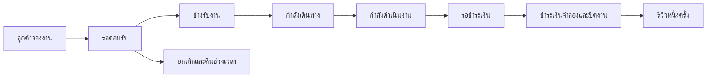

# FixFlow — WebApps Mini Project

## วัตถุประสงค์

เว็บจองช่างซ่อมบ้านในกรุงเทพมหานคร 50 เขต แสดงการทำงาน Full Stack: Auth, RBAC, CRUD, relational database, transaction, validation, status workflow และ deployment

## บทบาท

| บทบาท      | สิทธิ์                                                                  |
| ---------- | ----------------------------------------------------------------------- |
| Customer   | จองงาน ดูงานตัวเอง ยกเลิกก่อนนัด ชำระเงินจำลอง รีวิวงานที่เสร็จ         |
| Technician | ดูงานที่ถูกมอบหมาย รับ/ปฏิเสธงาน อัปเดตสถานะ เพิ่ม/ลบอะไหล่ระหว่างทำงาน |
| Admin      | จัดการผู้ใช้ ช่าง บริการ หมวดหมู่ งาน และ config พร้อม audit log        |

## Workflow

## ข้อมูลหลัก

- AppUser: UUID ตรงกับ Supabase Auth, role, สถานะใช้งาน
- District / TechnicianDistrict: พื้นที่รับงาน 50 เขต
- ServiceCategory / Service: หมวดหมู่แยกจากบริการและราคา
- Technician: ข้อมูลช่าง บัญชีผู้รับงาน วันทำงาน และช่วงเวลา
- UserImage: รูปโปรไฟล์และรูปประกอบใบสมัคร ผูกเจ้าของบัญชี รูปใบสมัครเข้าถึงได้เฉพาะเจ้าของและ Admin
- Booking / Slot: เจ้าของงาน ราคาสnapshot และ unique time slot
- JobStatusHistory: ลำดับสถานะ ผู้เปลี่ยน เวลา และหมายเหตุ
- JobPartItem / Payment: อะไหล่หน้างาน ยอดรวม และการชำระเงินจำลอง
- Review: คะแนน 1–5 และ unique booking review
- AppSetting / AuditLog / RateLimit: config, ประวัติการแก้ไข และป้องกันขอ OTP ถี่

## ขอบเขตสาธิต

ไม่ติดต่อช่างจริง ไม่มีโอนเงินจริง GPS tracking และ chat ยังไม่รวมในรุ่นนี้ รองรับรูปโปรไฟล์ทุกบทบาทและรูปประกอบใบสมัครช่าง 1–5 รูป โดย Admin ต้องตรวจใบสมัครก่อนเปิดรับงาน

## แนวทางสาธิตให้อาจารย์

1. ลูกค้า login แล้วเลือกช่าง/บริการ/เขต/วันเวลา
2. สลับบัญชีช่าง เปิดงาน รับงาน และอัปเดตสถานะตามลำดับ
3. เพิ่มอะไหล่หน้างาน แล้วส่งยอดเรียกเก็บ
4. ลูกค้าชำระเงินจำลองและรีวิว
5. Admin ตรวจงาน แก้ราคา ปิดเปิดบริการ และเปลี่ยน config
6. ทดลองสิทธิ์ผิดบทบาทและจองเวลาซ้ำ
7. อธิบาย database relations, transactions, authorization และ deployment
